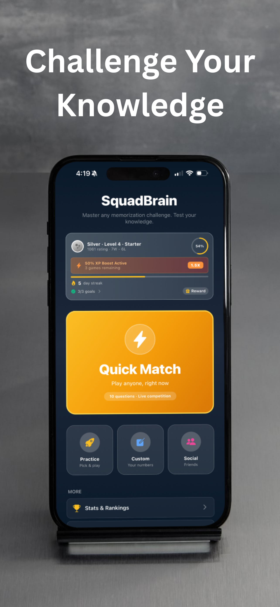
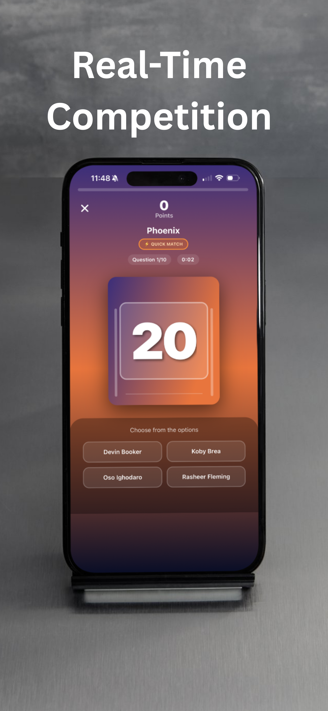

# SquadBrain

A sports roster learning app for iPhone and iPad.

[App Store](https://apps.apple.com/us/app/squadbrain/id6756122317) · [Case study](docs/case-study.md) · [Technical decisions](docs/engineering-decisions.md)

<a href="https://apps.apple.com/us/app/squadbrain/id6756122317"></a>
<a href="https://apps.apple.com/us/app/squadbrain/id6756122317"></a>
<a href="https://apps.apple.com/us/app/squadbrain/id6756122317"></a>

## Public examples

The App Store lists SquadBrain under Timothy Sullivan. The full app source is private. This repository contains selected TypeScript examples of its product logic, with tests and architecture notes.

| Area | Example |
| --- | --- |
| Session state | [Game-session state](examples/game-session-state.ts) |
| Competitive ranking | [Ranking](examples/ranking.ts) |
| Practice selection | [Adaptive practice](examples/adaptive-practice.ts) |
| Opponent matching | [Matchmaking](examples/matchmaking.ts) |
| Submitted-result checks | [Result validation](examples/result-validation.ts) |
| Roster data | [Roster normalization](examples/roster-normalization.ts) |
| Progression | [Achievement engine](examples/achievement-engine.ts) |

## Technical decisions

The examples separate application rules from screen code. The result validator recomputes correctness from player identifiers and flags inconsistent counts, duplicate prompts and suspicious timing. The practice and matching modules make their selection rules available to inspect.

Read the [architecture notes](docs/architecture.md) and [decision records](docs/adr/README.md) for the reasoning. The application stack described there is React Native, Expo, TypeScript and Firebase; the examples here can be run separately.

## Run locally

```bash
npm ci
npm run ci
```

The command type-checks the examples, runs their tests and generates coverage. Those checks cover the public examples and do not establish the quality of the entire app or its live services.

[Tim Sullivan](https://sulmusic2-star.github.io/) · [Contact](mailto:hello@lastingground.com)
